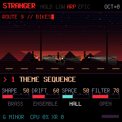

# STRANGER SYNTH

A performance synth for the M-VAVE FM-1 by **swtdr34mz**, in the spirit of 80s analogue film scores. Based on
[OFFWORLD](https://github.com/swtdr34mz-afk/OFFWORLD), built on [fm1-base](https://github.com/charlesvestal/fm1-base)
and [felucca-bsp](https://github.com/hugelton/felucca-bsp).

  

**Work in progress.** Unofficial: not made or supported by M-VAVE; at your own risk.

## Plan

1. Scaffold: name, splash, IDs, hub files (done: v0.0.1, still sounds like OFFWORLD)
2. LOW SPLIT + arpeggiator (synced to MIDI clock) (done: v0.0.2)
3. Presets in the style of classic 80s poly and mono synths (done: v0.0.3)
4. CHORD mode with sidechain, TONE FOLLOW (to the low split or the chords) (done: v0.0.3)
5. Performance FX: tape stop, VHS wobble, tape rewind, gated reverb, tape echo throw, lights out, walkie, riser (done: v0.0.3)
6. The screen: a small town at night, the mirror world (done: v0.1.0)
7. SIX MACHINES sends MIDI clock and its kick as the sidechain trigger (done: v0.2.0, and SIX MACHINES' MIDI out)

## Build

`X0X_FONTSET=terminus python3 fm1-base/tools/build.py . --host`, then `build/host/stranger_synth_host tests/basic.txt build/host`.
GitHub Actions builds the `.fwsc` on every push (Actions > the run > Artifacts) and attaches it to a release on a tag `v*`.

## The arpeggiator (v0.0.2)

- **ARP** (tap): the arpeggiator on / off. With the low split on it plays the left hand (the right hand plays free and
  follows it); with the split off, every key. LOW HOLD keeps its notes running. **ARP held 1 s**: EPIC.
- **LFO**: the ARP page. K1 RATE (1/4, 1/8, 1/8T, 1/16, 1/16T, 1/32), K2 PATTERN (UP, DOWN, UP-DOWN, PLAYED, RANDOM),
  K3 OCTAVES (1..4), K4 GATE (5..100 %). SELECT on this page: the tempo (40..240 BPM).
- **MIDI clock** in (USB or the TRS jack): the arp follows it (START from the first step, STOP silent); the page shows EXT CLOCK.

## Sounds, chords, performance (v0.0.3)

- **Ten presets** in the manner of classic 80s analogues (our own names): NIGHT SEQUENCE, FIVE BRASS, CHORUS STRINGS,
  MODEL BASS, OB BRASS, SIX PAD, MONO ARP BASS, SYNC LEAD, MIRROR CHOIR, THE DARK BELOW.
- **The knobs (MAIN)**: K1 SHAPE (PLUCK, STAB, BRASS, SWELL, PAD), K2 DRIFT (CLEAN, ANALOG, ENSEMBLE, WIDE, TAPE),
  K3 SPACE (ROOM .. FREEZE), K4 FILTER (DARK, WARM, OPEN, BRIGHT, SCREAM). OFFWORLD's rain is gone.
- **CHORD** (ENV): K1 CHORD (OFF, MINOR, MAJOR, MIN7, MAJ7, SUS2, SUS4, POWER, MIN9, ADD9) from one finger (the low split,
  or every key with the split off; with ARP the arp plays the chord), K2 SPREAD (CLOSE, OPEN, WIDE), K3 SIDECHAIN depth,
  K4 SC RATE (1/4, 1/8, 1/2, KICK: a kick on MIDI channel 10, note 36).
- **FOLLOW CHORD** (SEL page, FOLLOW): the right hand's white keys play the chord's notes.
- **PERFORM**: FX held + one of the lowest eight white keys switches an effect (while FX is held, the keys of the
  effects that are on light up); FX tapped shows the PERFORM page (the keys play as always there). The effects:
  TAPE STOP, VHS, REWIND (once), GATED reverb, ECHO throw, LIGHTS OUT, WALKIE, RISER. The knobs stay the macros.
- **PLAY**: TAPE STOP (again: it spins back up). **REC**: HOLD (every note stays); REC held 1 s: every note off.

## The screen (v0.1.0)

- **The intro**: a VCR wakes up, a red storm rises over the trees and houses, a bike crosses, the title buzzes on in red neon.
- **Eight places**, one night (a VCR clock in the corner), cut with a tape tear and colour bars every 18 to 35 s:
  MAPLE LANE, THE WOODS, THE LAB, ROUTE 9, THE BASEMENT, THE SKY, RADIO TOWER, THE ARCADE. Windows, lamps, headlights,
  fireflies, arcade screens and sparks follow the notes; in the red storm the notes bring lightning.
- **The MIRROR**: while PERFORM effects play, the picture turns over into a cold, dark copy of itself, red at the
  brightest, ash floating up, the tracking line rolling. All drawn here; no figures, logos or images from any film or show.

## LINK: two FM-1s (v0.2.0)

**SAVE** switches LINK on: STRANGER SYNTH's USB port plays host. Connect the FM-1 running SIX MACHINES to it (an OTG
cable or adapter; the port gives no power, so the other FM-1 runs on its battery or through a powered hub). The header
shows LNK (green: connected). SIX MACHINES' clock then drives the arp and the sidechain (START, STOP), and with
SC RATE at KICK its kick ducks the sound. SAVE again: back to the computer (no computer while LINK is on).

## v0.2.1

- PLAY: TAPE STOP; REC: HOLD (no deep root under it); FX + key for the effects, their keys lit while FX is held.
- No sounds from the screen any more (the crackle of the flickering lights); drier presets; STRANGER's own colours.

## v0.3.0: the sounds of the scores

Seven new presets, tuned against reference recordings (their brightness, noise, decay, partials, stereo width):
**THEME SEQUENCE** (two saws and the sub under a resonant filter nearly shut: FILTER opens it), **KIDS ON BIKES**
(bright pulse, wide chorus, air), **LAZY NIGHT** (dark detuned plucks), **DIRTY BELLS** (a ringing sine against a saw
2.57 times up, hiss, tape grit), **CHAOS** (a grinding minor second, ring, warp), **END CREDITS** and **CREDITS RISE**
(calm to drastic with FILTER: at SCREAM it drives). New in the engine: RING, NOISE and PLUCK per preset; FILTER at
SCREAM drives. The arp's tempo starts at 84 BPM (1/16).

## v0.4.0

- **ALGORITHM: SIZE** (was VIBRATO): the sound bigger in one turn: the ensemble chorus, the stereo width, a little
  detune, more and longer reverb, a touch of delay. (VIBRATO stays on the PRESSURE page, K4.)
- **KIDS ON BIKES** the Juno-60 way (saw and pulse together, the square sub, chorus, long ring); **LAZY NIGHT** sour
  (a tritone beside it, ring, wobble); **DARK BELLS** replace DIRTY BELLS (sines ringing out of tune, smooth, a canyon
  of reverb); **FIVE BRASS** from below (an octave down, deeper, a cathedral); **MODEL BASS** starts on the arp
  (UP-DOWN). END CREDITS and CREDITS RISE are gone: 13 presets.

## v0.5.0: the HEART

- **HEART** (EDIT; again: GLIDE): a heartbeat as the groove, at the tempo or SIX MACHINES' clock. K1 the level (0: off),
  K2 SINGLE / DOUBLE (lub-dub) / SLOW / RACING, K3 REAL (an analogue kick toward a real heart's muffled thump),
  K4 DECAY. SC RATE **HEART** (CHORD page): the sidechain ducks on every beat. The picture pulses red with it.
- **THEME SEQUENCE** starts on the arp (UP-DOWN) and holds a deep root an octave under the arp's lowest note; a wall
  of detuned saws. FILTER opens much further now (BRIGHT, SCREAM).
- **NOIR TAPE** replaces DARK BELLS (a hollow square synth from a worn tape: wobble, hiss, the highs gone).
- **MONO ARP BASS** starts on the arp (UP-DOWN); **SYNC LEAD** wider, with a long hall.

## v0.6.0

- **THEME SEQUENCE** starts in the LOW SPLIT two octaves down (the left hand the bass) with the right hand on the arp
  (UP-DOWN), the filter open. On the ARP page, with the split on, ARP tapped switches the hand the arp plays.
- **The intro** runs about 4 s after the boot: the lightning strikes and in its light a vast eye of cloud turns over the
  whole sky (our own), a second flash, then the name. (v0.6.2: the eye became roots hanging from the clouds.)
