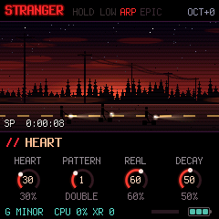

# STRANGER SYNTH

A performance synth for the M-VAVE FM-1 by **swtdr34mz**, in the spirit of the 80s analogue film scores: walls of
detuned saws, resonant filters opening slowly, arps that pulse under everything, tape that stops and warps. Built for
playing live: a low split two octaves down, an arpeggiator that follows the clock, chords from one finger, a sidechain,
a heartbeat as the groove, eight performance effects, and a second FM-1 running SIX MACHINES as its drummer.
Based on [OFFWORLD](https://github.com/swtdr34mz-afk/OFFWORLD), built on [fm1-base](https://github.com/charlesvestal/fm1-base)
and [felucca-bsp](https://github.com/hugelton/felucca-bsp).

   

**Manual:** [English](docs/MANUAL.md) · [Deutsch](docs/HANDBUCH.md) · **Try it in the browser:** [emulator](https://swtdr34mz-afk.github.io/STRANGER_SYNTH/emu/)

**Install:** download the `.fwsc` from [Releases](https://github.com/swtdr34mz-afk/STRANGER_SYNTH/releases) and install it
as any FM-1 firmware. Unofficial: not made or supported by M-VAVE; at your own risk.

## What it does

- **13 presets** in the manner of classic 80s analogues and the film scores of the time (the names are our own):
  THEME SEQUENCE, KIDS ON BIKES, LAZY NIGHT, NOIR TAPE, CHAOS, FIVE BRASS, CHORUS STRINGS, MODEL BASS, OB BRASS,
  SIX PAD, MONO ARP BASS, SYNC LEAD, MIRROR CHOIR. Some start set up to play: THEME SEQUENCE in the low split with the
  right hand on the arp, MODEL BASS and MONO ARP BASS on the arp (UP-DOWN).
- **Four macro knobs on sweetspots**: SHAPE (PLUCK .. PAD), DRIFT (CLEAN .. TAPE), SPACE (ROOM .. FREEZE),
  FILTER (DARK .. SCREAM, where it also drives). **SIZE** on ALGORITHM makes everything bigger at once (chorus, width,
  room), **TONE** on SELECT darker or brighter.
- **LOW SPLIT** (1 to 3 octaves down) with **LOW HOLD**, and **FOLLOW**: the right hand in the scale or on the chord of
  the left (SNAP, WHITE, CHORD).
- **ARPEGGIATOR**: 1/4 to 1/32 with triplets, UP, DOWN, UP-DOWN, PLAYED, RANDOM, 1 to 4 octaves, gate; on either hand;
  its own tempo or MIDI clock.
- **CHORD**: ten chords from one finger with three voicings; with the arp, the arp plays the chord.
- **SIDECHAIN**: at 1/4, 1/8, 1/2, on a kick from outside (MIDI channel 10, note 36) or on the HEART.
- **HEART**: a heartbeat as the groove, SINGLE, DOUBLE (lub-dub), SLOW, RACING, from an analogue kick to a real
  heart's muffled thump.
- **PERFORM**: TAPE STOP, VHS, REWIND, GATED reverb, ECHO throw, LIGHTS OUT, WALKIE, RISER, from the keys while FX is
  held; TAPE STOP on PLAY.
- **LINK**: the USB port plays host to a second FM-1 with SIX MACHINES (its clock and kick drive the arp, the heart
  and the sidechain), or to a USB-MIDI controller.
- **The screen**: a small town at night, eight places cut like a worn video tape (a street, the woods, the lab, a
  road with bikes, a basement door, a red storm, a radio tower, the arcade); lights, headlights and fireflies follow the
  notes, the picture pulses with the heart, and while the effects play it turns over into a cold, dark mirror of itself.
  All drawn in the firmware.

## The controls

| Control | Does |
| --- | --- |
| K1..K4 | SHAPE, DRIFT, SPACE, FILTER (on a page: the page's four) |
| SELECT / ALGORITHM / PRESET | TONE / SIZE / the preset (SELECT on the ARP page: the tempo) |
| PLAY | TAPE STOP (again: it spins back up) |
| REC | HOLD (every note stays); held 1 s: all notes off |
| SEQ | LOW HOLD |
| ARP | the arpeggiator; held 1 s: EPIC (fifth and octave); on the ARP page: which hand |
| SEL | SPLIT page (SPLIT, POINT, SCALE, FOLLOW); held + a key: the split there |
| GLO | PRESSURE page (PRESSURE, AMOUNT, TONE, VIBRATO) |
| EDIT | HEART page (HEART, PATTERN, REAL, DECAY); again: GLIDE; again: MAIN |
| ENV | CHORD page (CHORD, SPREAD, SIDECHAIN, SC RATE) |
| LFO | ARP page (RATE, PATTERN, OCTAVES, GATE) |
| FX | PERFORM page; FX held + one of the lowest eight white keys: an effect on / off (lit while held) |
| SAVE | LINK: the USB port as host (again: back to the computer) |
| HOME | MAIN; held 1 s: the preset's knobs as they came; twice: the controls drawn on the screen |
| OCT- / OCT+ | the octave |

## Two FM-1s

Switch LINK on (SAVE) on STRANGER SYNTH and connect the FM-1 running [SIX MACHINES](https://github.com/swtdr34mz-afk/SIX_MACHINES)
(its current version, with MIDI out: clock, START / STOP and its kick) to its USB port with an OTG cable or adapter. The port
gives no power: the other FM-1 runs on its battery or through a powered hub. The header shows LNK, green when connected.

## Build

`X0X_FONTSET=terminus python3 fm1-base/tools/build.py . --host`, then `build/host/stranger_synth_host tests/basic.txt build/host`
(and arp, split, glide, perform, link, heart). GitHub Actions builds the `.fwsc` on every push and attaches it to a
release on a tag `v*`; the browser emulator goes to GitHub Pages.

The sound engine is `dsp/engine.c` with `dsp/arp.c`, `dsp/perform.c` and `dsp/heart.c`; the screen is `film.c` with
`scenes.c`; the controls and pages are `app.c`.

## v0.9.0: the facelift

Smoother pictures on the same 240 x 240 screen: skies without bands (dithered), soft glows round lamps, lights and the
red door, soft beams for the headlights and flashlights, anti-aliased wires. ROUTE 9 redrawn: a flat road, a line of
pines against the red glow, fog, telephone poles running away. A camcorder's viewfinder over the picture: the battery as
a small cell with three bars (no number; a plug on USB power; it blinks when nearly empty) and the tape counter. The
knobs as rings with their sweetspots, the title with a neon glow.

(v0.8.1: the battery moved out of the picture into the panel's bottom right corner: a small, quiet cell with three soft bars.)
